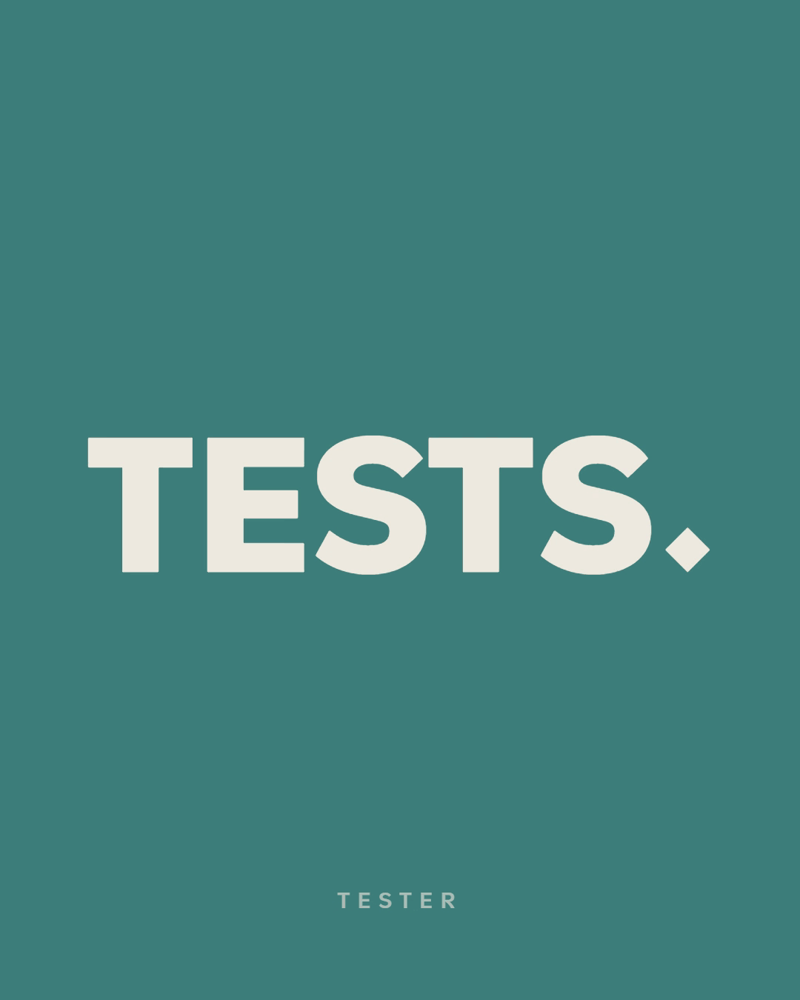

  

<h1 align="center">Nader Alzghoul · نادر الزغول</h1>

<b>A QA engineer who tests like a skeptic and teaches like a coach.</b> QA Automation Engineer in Amman, Jordan

  
  

---

### 

- QA Automation Engineer at TaqneenSoft in Amman since August 2026.
- JFDA portal: Playwright end-to-end tests and a staged automation suite shared with the developers.
- MOA portal: manual testing, defect reports and Playwright automation.
- [Shalwa Automation Project](https://github.com/NJ-Burrito/Shalwa-Automation-Project-SAP-): a Java, Selenium, Maven and JUnit framework with 6 page objects.
- ISTQB CTFL, ISTQB Advanced Test Automation Engineering and ISTQB AI Testing.

### 

- AI tutor at Zaha Cultural Center: AI, machine learning and robotics with PictoBlox, Arduino and ESP32, for students aged 8 to 16.
- Ten PictoBlox and Arduino project plans, from a door that opens when a visitor comes closer than 30 cm to an AI fitness coach.
- AI Advanced Track, GIG | Innovation Nation (Robotna), 132 hours.

### 

- Session facilitator with Generations For Peace since September 2025: 8 practical sessions of volleyball, basketball and art for peace.
- 3am3dna, since January 2019: management and field assistance for poverty alleviation.

### 

- [Profile-Wrap](https://github.com/NJ-Burrito/Profile-Wrap): an open-source (MIT) tool that plans, writes and checks LinkedIn posts, and posts only through LinkedIn's official API after you tap Allow. [Site](https://nj-burrito.github.io/Profile-Wrap/)
- [NJ-Kit](https://github.com/NJ-Burrito/NJ-Kit): a free working method for Claude Code, 43 skills that each end with a script that says PASS or FAIL. Open source (MIT), in Arabic and English. [Site](https://nj-burrito.github.io/NJ-Kit/)
- [QA Wrap](https://github.com/NJ-Burrito/QA-Wrap): a local-first QA toolkit that lives in your browser. It records a test session, links every failure to the action that caused it, and writes the bug report for you. [Site](https://nj-burrito.github.io/QA-Wrap/)
- SRS documents built from portal evidence, and bilingual Arabic and English user, staff and training manuals for the JFDA portal.
- Diploma in AI and Robotics Engineering, Al-Balqa Applied University. Advanced Data Analytics, Correlation One, 250 hours.

---

### Latest LinkedIn posts

<!-- posts:start -->
- [The test pyramid for a web portal](https://www.linkedin.com/feed/update/urn:li:share:7519390873592328193/) · 2026-10-23
- [Same bug, two layers: API first, then UI](https://www.linkedin.com/feed/update/urn:li:share:7519017308372230145/) · 2026-10-22
- [Why agents prefer roles to CSS selectors](https://www.linkedin.com/feed/update/urn:li:share:7518669986274525185/) · 2026-10-21
- [Code bug or wiring bug?](https://www.linkedin.com/feed/update/urn:li:share:7518311294031302657/) · 2026-10-20
- [Two age groups, one eight-session course](https://www.linkedin.com/feed/update/urn:li:share:7518000411304460290/) · 2026-10-19
- [Idea in. Post out.](https://www.linkedin.com/feed/update/urn:li:share:7517594189719752704/) · 2026-10-18
- [Hate the blank page?](https://www.linkedin.com/feed/update/urn:li:share:7517224204178661376/) · 2026-10-17
- [الفن يفتح باب الحوار](https://www.linkedin.com/feed/update/urn:li:share:7516846752663220224/) · 2026-10-16
- [Three AI projects, one course](https://www.linkedin.com/feed/update/urn:li:share:7516540827913981953/) · 2026-10-15
- [A door that opens at 30 cm](https://www.linkedin.com/feed/update/urn:li:share:7516148407871184896/) · 2026-10-14
<!-- posts:end -->

Nothing ships half-done. · لا شيء يُسلَّم ناقصًا.

