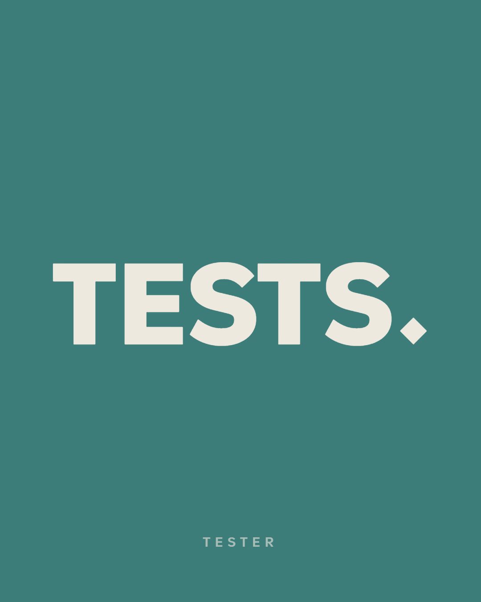

<h1 align="center">Nader Alzghoul (NJ-Burrito) · نادر الزغول</h1>

<b>Nader Alzghoul (NJ-Burrito)</b> is a QA Automation Engineer in Amman, Jordan. Portfolio: <a href="https://nj-burrito.github.io/">nj-burrito.github.io</a> · <a href="https://www.linkedin.com/in/nader-alzghoul">LinkedIn</a> · <a href="https://github.com/NJ-Burrito">GitHub</a> Tools: <a href="https://nj-burrito.github.io/QA-Wrap/">QA-Wrap</a> · <a href="https://nj-burrito.github.io/NJ-Kit/">NJ-Kit</a> · <a href="https://nj-burrito.github.io/Profile-Wrap/">Profile-Wrap</a> · <a href="https://nj-burrito.github.io/Business-Wrap/">Business-Wrap</a> · <a href="https://nj-burrito.github.io/NJ-Whip/">NJ-Whip</a> · <a href="https://nj-burrito.github.io/NJ-Flush/">NJ-Flush</a> · <a href="https://nj-burrito.github.io/story-wrap/">Story-Wrap series</a>

  

<b>QA Automation Engineer in Amman, Jordan</b> A QA engineer who tests like a skeptic and teaches like a coach.

نادر الزغول، مهندس أتمتة ضمان الجودة في عمّان، الأردن

Also known as NJ Burrito · NJBurrito · NJ

  
  

**In short**

- QA for 100+ government e-services (JFDA and MOA portals), with Playwright.
- Builds free, open-source tools, listed below.
- Teaches AI and robotics to students aged 8 to 16.

| Tool | What it does | بالعربية | Links |
|---|---|---|---|
| **QA-Wrap** | Browser extension: records a test session, links every failure to the action that caused it, and writes the bug report | إضافة متصفح تسجّل جلسة الاختبار وتربط كل خطأ بالنقرة التي سبّبته وتكتب تقرير الخلل | [Site](https://nj-burrito.github.io/QA-Wrap/) · [Code](https://github.com/NJ-Burrito/QA-Wrap) |
| **NJ-Kit** | A working method for Claude Code: 49 skills (30 in the plugin), each ending in a script that says PASS or FAIL | طريقة عمل لـ Claude Code: مهارات تنتهي كل منها بفحص ينجح أو يفشل | [Site](https://nj-burrito.github.io/NJ-Kit/) · [Code](https://github.com/NJ-Burrito/NJ-Kit) |
| **Profile-Wrap** | Plans, writes and checks LinkedIn posts; posts only through LinkedIn's official API after you tap Allow | يخطّط منشورات LinkedIn ويكتبها ويفحصها، ولا ينشر إلا بعد موافقتك | [Site](https://nj-burrito.github.io/Profile-Wrap/) · [Code](https://github.com/NJ-Burrito/Profile-Wrap) |
| **Business-Wrap** | Bilingual (Arabic + English) requirements documents from evidence, edited on the page that prints, exported to PDF and DOCX. Claude Code plugin + MCP server | وثائق متطلبات ثنائية اللغة (عربي وإنجليزي) من الأدلة، تُصدَّر إلى PDF وDOCX | [Site](https://nj-burrito.github.io/Business-Wrap/) · [Code](https://github.com/NJ-Burrito/Business-Wrap) |
| **NJ-Whip** | An on-screen whip for Claude Code on Windows: swing it with the mouse and it cracks and types a short message that steers how Claude works. 15 whips, one exe of about 6.5 MB | سوط على الشاشة لـ Claude Code على ويندوز: تلوّح به فيفرقع ويكتب رسالة توجّه عمل Claude | [Site](https://nj-burrito.github.io/NJ-Whip/) · [Code](https://github.com/NJ-Burrito/NJ-Whip) |
| **NJ-Flush** | Frees Windows RAM with one double-click while a toilet flushes it; four flush tiers by RAM in use | يحرّر ذاكرة ويندوز بنقرة مزدوجة مع رسم مرحاض يسحب الماء | [Site](https://nj-burrito.github.io/NJ-Flush/) · [Code](https://github.com/NJ-Burrito/NJ-Flush) |
| **Story-Wrap** | Claude Code toolkit for automated Arabic interactive animated story reels: script, voice, sound, compose, publish | أدوات لـ Claude Code لصنع مقاطع قصص عربية تفاعلية متحركة آليًا | [Site](https://nj-burrito.github.io/story-wrap/) · [Code](https://github.com/NJ-Burrito/Story-Wrap) |
| **Playwright TS Showcase** | Playwright + TypeScript test project: Page Object Model, fixtures and CI | مشروع اختبارات Playwright بلغة TypeScript بنمط Page Object | [Code](https://github.com/NJ-Burrito/playwright-ts-showcase) |
| **Shalwa Automation Project** | Java, Selenium WebDriver, Maven and JUnit framework (Page Object Model) for SauceDemo | إطار أتمتة اختبارات بلغة Java وSelenium لموقع SauceDemo | [Code](https://github.com/NJ-Burrito/Shalwa-Automation-Project-SAP-) |

**Toolbox:** Playwright · Selenium · Cypress · Appium · Postman · REST Assured · JMeter · Java · Python · SQL · GitHub Actions · Azure DevOps

---

### 

- QA Automation Engineer at TaqneenSoft in Amman since August 2026.
- JFDA portal: Playwright end-to-end tests and a staged automation suite shared with the developers.
- MOA portal: manual testing, defect reports and Playwright automation.
- [Shalwa Automation Project](https://github.com/NJ-Burrito/Shalwa-Automation-Project-SAP-): a Java, Selenium, Maven and JUnit framework with 6 page objects.
- ISTQB CTFL, ISTQB Advanced Test Automation Engineering and ISTQB AI Testing.

### 

- AI tutor at Zaha Cultural Center: AI, machine learning and robotics with PictoBlox, Arduino and ESP32, for students aged 8 to 16.
- Ten PictoBlox and Arduino project plans, from a door that opens when a visitor comes closer than 30 cm to an AI fitness coach.
- AI Advanced Track, GIG | Innovation Nation (Robotna), 132 hours.

### 

- Session facilitator with Generations For Peace since September 2025: 8 practical sessions of volleyball, basketball and art for peace.
- 3am3dna, since January 2019: management and field assistance for poverty alleviation.

### 

- QA-Wrap, NJ-Kit, Profile-Wrap, Business-Wrap, NJ-Whip, NJ-Flush and Story-Wrap: seven free, open-source tools, listed at the top.
- SRS documents built from portal evidence, and bilingual Arabic and English user, staff and training manuals for the JFDA portal.
- Diploma in AI and Robotics Engineering, Al-Balqa Applied University. Advanced Data Analytics, Correlation One, 250 hours.

---

### Latest LinkedIn posts

<!-- posts:start -->
- [Severity vs priority with one example each](https://www.linkedin.com/feed/update/urn:li:share:7532063125639041024/) · 2026-11-27
- [Cart persistence: what the test really checks](https://www.linkedin.com/feed/update/urn:li:share:7531696955526402049/) · 2026-11-26
- [NJ-Whip: 15 whips, each with its own crack](https://www.linkedin.com/feed/update/urn:li:share:7530991033845940224/) · 2026-11-24
- [One portfolio, English and Arabic](https://www.linkedin.com/feed/update/urn:li:share:7530674819093241856/) · 2026-11-23
- [Story-Wrap: the tool for Arabic story reels](https://www.linkedin.com/feed/update/urn:li:share:7530301896767524864/) · 2026-11-22
- [A motion rule your CSS can fail](https://www.linkedin.com/feed/update/urn:li:share:7529926537270173696/) · 2026-11-21
- [Not only an SRS: 17 document types, one start page](https://www.linkedin.com/feed/update/urn:li:share:7529526540829851649/) · 2026-11-20
- [Let your coding agent read the bug report](https://www.linkedin.com/feed/update/urn:li:share:7528805402877247488/) · 2026-11-18
- [NJ-Whip: steer Claude Code with a crack](https://www.linkedin.com/feed/update/urn:li:share:7528473213023174656/) · 2026-11-17
- [6 page objects, one reviewable flow](https://www.linkedin.com/feed/update/urn:li:share:7526638812597207042/) · 2026-11-12
<!-- posts:end -->

Nothing ships half-done. · لا شيء يُسلَّم ناقصًا.

